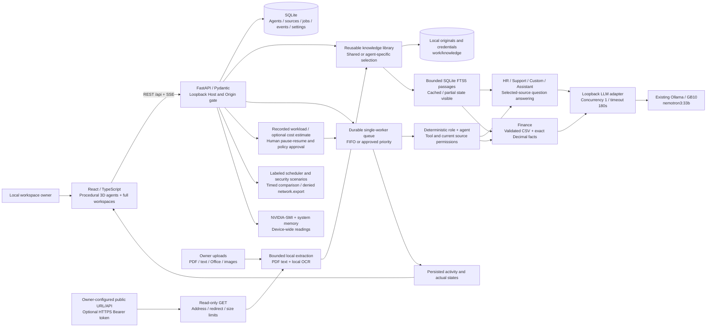

# LocalOps AI architecture

The loopback application owns durable state and job execution; the browser renders the living workspace, and the existing Ollama service performs inference on the GX10. Explicitly configured website/API sources fetch read-only public endpoints; model inference has no hosted fallback.

## Components and durability

- **Frontend:** `apps/web`. Original procedural meshes give every visible agent its own exact-ID body and reusable portrait; up to 30 identities. Full agent pages use seven tabs. A shared KnowledgePanel supports the library, creation dialog, and each agent. The local assistant has explicit source selection and recent conversation context. Centered controls, keyboard activation, reduced motion, and agent lists support accessibility. The main canvas stays mounted while hidden between views.
- **API:** `services/api/app/main.py`. Schemas validate agent/source/task configuration. REST exposes health, knowledge uploads/links/access/refresh, agents/insights/controls, jobs, assistant, telemetry, and controlled scenarios. The API serves `apps/web/dist` from the same loopback origin; SSE sends snapshots and actual transitions.
- **Storage:** `work/localops.sqlite3` retains agent identities, assignments, extracted source records, jobs/results, activity, policy, and latest comparison. Uploaded originals, multipart spool files, and source credentials remain under `work/knowledge`. Preserve both database and knowledge directory when backing up. Archived project materials are not normal knowledge inputs.
- **Lifecycle:** `scripts/service.sh` manages an independently running transient systemd user service, verifies project ownership, and restarts on failure. It lasts for the current user session without enabling reboot startup. Queue recovery marks interrupted work visibly rather than pretending inference completed.

## Knowledge and execution boundaries

Uploads have a 25 MiB limit; indexed text is bounded to 200,000 characters with a 12,000-character preview. PDF text is limited to 100 pages, PDFs over 250 pages are refused, and textless scanned PDFs use OCR on the first five pages. DOCX/XLSX/PPTX extraction reads stored text/cached values without running formulas or macros. Common images use local OCR. Unsupported/partial/unreadable formats remain visibly stored, partial, or errored; extraction is not general image understanding.

Read-only URL/API fetching accepts explicit public HTTP/HTTPS addresses on ports 80/443 with a 5 MiB response cap and 15-second timeout. Private, loopback, link-local, and reserved destinations are refused, with validated/pinned addresses and rechecked redirects. Optional API Bearer authentication requires HTTPS, excludes redirects, and uses a dedicated credential field. Tokens are in local files with restrictive permissions and redacted from public metadata/previews; provider OAuth, imported browser sessions, and JavaScript rendering are not implemented.

Linked sources refresh manually or on a periodic snapshot schedule (UI: 5/15/60 minutes). Last sync denotes successful extraction. A failed refresh keeps last successful cached text, error, and timestamp; cached and partial states are shown. This is not streaming synchronization. Reading stored knowledge does not itself fetch a new remote snapshot.

Shared sources are available to current and future agents; private sources require explicit assignment. Business jobs snapshot selected sources when queued and recheck current access before execution. The assistant is a separate internal identity: the local owner selects exactly which library sources it should read, including private sources. Omitted source selection at the API defaults to shared records; an explicit empty list remains empty. Recent conversation context is bounded to six messages.

Local SQLite FTS5 selects bounded passages. Broad summary/recommendation requests can use representative excerpts; unmatched factual questions abstain instead of injecting archived sample data. Citation IDs are validated against supplied passages, which is not complete semantic fact checking. Source content is untrusted data and cannot grant tool permissions.

Finance's exact path requires one complete validated CSV ledger with unique `vendor,invoice_id,due_date,amount,status,category` headers. Exact Decimal sums retain raw and first-record-per-ID totals separately and expose duplicate row references. The model narrative is checked against calculation fields; invalid narration remains an observable error with evidence. Other financial documents use grounded question answering, not a spreadsheet execution engine.

Ordinary Python functions implement the small allowlisted tool set. There is no arbitrary shell/code execution, payment, messaging, or record-export tool. The controlled security scenario proposes `network.export`, then deterministic authorization refuses dispatch before an external action. Explicit owner-configured read-only source GET requests are separate from agent tools.

## Measurements and scope

The scheduler runs one inference request at a time. Pausing holds intake/queued jobs without interrupting active work or unloading shared weights. Human policy approval affects pending queue order; running work is not preempted. The optional FIFO/priority comparison measures bounded synthetic timed work, not inference throughput or GPU efficiency.

Physical utilization, temperature, and power describe the whole GX10. Job tokens, inference time, queue wait, and processing time describe requests. GB10 GPU memory counters are unavailable rather than inferred. Optional rate-based cost calculations are estimates, not bills, exclusive allocations, savings, or payments.

Current acceptance is in [VERIFICATION.md](VERIFICATION.md). WAN-disconnected acceptance still requires [OFFLINE_TEST.md](OFFLINE_TEST.md). Local single-owner use is the deployment scope; enterprise identity/multiuser isolation, provider OAuth, advanced retrieval evaluation, and robust process sandboxing remain future work. The older `evidence/architecture.svg` is retained as a historical illustration; the diagram above describes the current knowledge-backed system.
