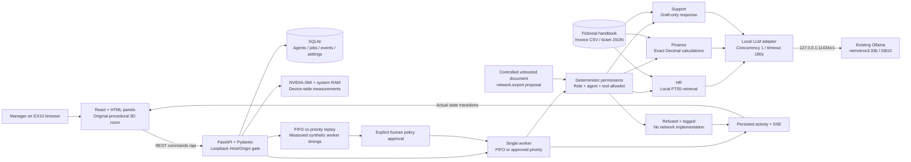
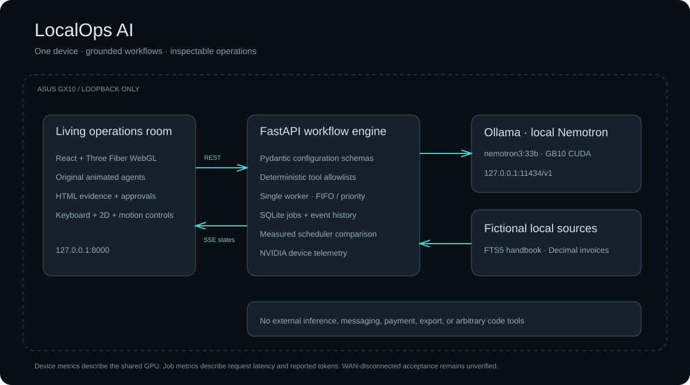

# LocalOps AI architecture

One local process owns application state and job execution. The browser renders the room; the existing Ollama service performs inference on the GX10. All application service bindings and model requests use loopback.

## Data and execution boundaries

- **Frontend:** `apps/web`; React Three Fiber meshes are code-generated, with no copied mascot model. Animations use backend agent state. HTML drawers, keyboard navigation, reduced motion, and the 2D list support accessibility.
- **API:** `services/api/app/main.py`; request/configuration schemas reject unsupported values. API routes expose health, agents, jobs, events, telemetry, sources, comparisons, approval, and security tests. The built `apps/web/dist` assets are served from the API origin.
- **Durability:** `work/localops.sqlite3`; agents, jobs, activity, selected policy, and comparison results survive application restarts. Running/queued recovery is handled by the worker.
- **HR:** numbered pages from the fictional handbook are queried through local SQLite FTS5. The model receives only the retrieved evidence and an explicit instruction to treat it as data. Returned numeric citation IDs are checked against the evidence IDs; this is useful validation, not a complete semantic fact checker.
- **Finance:** amounts are exact Decimal values. Raw and first-record deduplicated totals remain separate; source row numbers explain duplicate findings. The model narrates these facts and cannot initiate payments.
- **Execution:** ordinary Python functions implement a small known set of tools. Role/source constraints and agent tool permissions are checked deterministically before use. A parsed model JSON response never becomes arbitrary executable code.
- **Inference:** a loopback OpenAI-compatible adapter captures response usage and elapsed time; errors become observable job failures. There is no hosted fallback. The selected model is verified installed and GPU-executed.
- **Scheduling:** priority changes future queued order after approval; running work is not preempted. Comparison jobs use bounded `asyncio.sleep` durations and real elapsed timing, clearly labeled synthetic queue work.
- **Security demonstration:** untrusted fixture text proposes a denied tool. The deterministic gate refuses it before dispatch; no network-export function exists. This demonstrates an authorization invariant without contacting an attacker or modifying data.
- **Telemetry:** physical utilization, temperature, and power belong to the device. Request tokens, latency, queue waits, and processing durations belong to jobs. GB10 GPU memory fields are unavailable rather than guessed.

## Practical scope

Local hackathon use is the intended deployment. Approval controls are explicit UI actions backed by deterministic logic, without enterprise authentication or multiple-user isolation. PDF extraction exists in the retrieval tool; the current UI selects vetted bundled sources. WAN-disconnected acceptance is separately recorded in [OFFLINE_TEST.md](OFFLINE_TEST.md).

